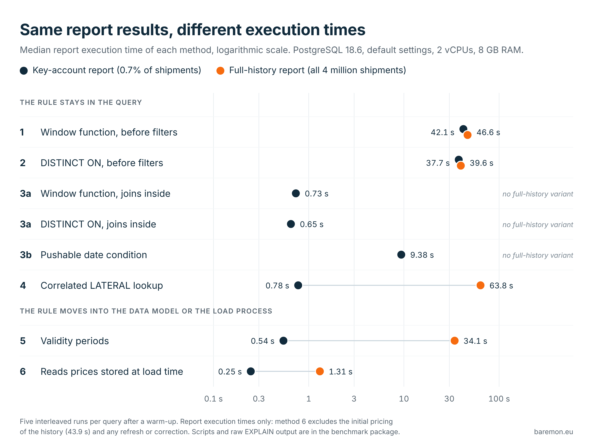

# As-of lookups in PostgreSQL: benchmark

Scripts, raw measurements and results for the Baremon article [Which Rate Applied? Six Ways to Solve an As-Of Lookup in PostgreSQL](https://www.baremon.eu/postgresql-as-of-lookup/) by Jan Suchánek.

The benchmark prices 4,000,000 synthetic shipments with the freight rate that was valid on the day each one was shipped, and compares six ways of finding that rate in PostgreSQL: a window function or `DISTINCT ON` with the ranking before or after the report filters, a correlated `LATERAL` lookup, explicit validity periods with an exclusion constraint, and prices stored at load time. Every method runs as a selective key-account report for one quarter (28,206 shipments); methods 1, 2, 4, 5 and 6 also run as a report over the full history.



## Results

| Method (PostgreSQL 18.6) | Key-account report | Full-history report |
|---|---:|---:|
| 1. Window function, ranking before the report filters | 42.1 s | 46.6 s |
| 2. `DISTINCT ON`, ranking before the report filters | 37.7 s | 39.6 s |
| 3a. Report joins inside the ranking step, window function | 0.73 s | – |
| 3a. Report joins inside the ranking step, `DISTINCT ON` | 0.65 s | – |
| 3b. `ship_day` in `PARTITION BY`, quarter restated as a date range | 9.38 s | – |
| 4. Correlated `LATERAL ... ORDER BY ... LIMIT 1` | 0.78 s | 63.8 s |
| 4, derived values named in CTEs instead of `LATERAL` | 0.84 s | – |
| 5. Explicit validity periods | 0.54 s | 34.1 s |
| 5, derived values stored as generated columns | – | 33.9 s |
| 6. Priced at load time (reads stored prices) | 0.25 s | 1.31 s |

Median of five interleaved runs after a warm-up, report execution time only. Method 6 excludes the initial pricing of the history, `CREATE TABLE ... AS` 43.9 s and primary key 3.03 s (one run each, `setup_methods.log`), and any later refresh or correction.

Minimum, maximum and result hash of every query are in [`results/pg18/summary.md`](results/pg18/summary.md), and the raw `EXPLAIN (ANALYZE, BUFFERS, TIMING OFF)` output of every run is next to it. The timings describe the formulations in [`queries/`](queries/), not the best achievable implementation of each technique. Absolute times depend on the machine, so compare the methods with each other. The article explains the plans behind the numbers.

## Repository layout

| Path | Contents |
|---|---|
| [`setup.sql`](setup.sql) | Schema and data generator |
| [`setup_methods.sql`](setup_methods.sql) | Structures for methods 5 and 6 and for the stored-column variant |
| [`queries/`](queries/) | Every timed query, one per file |
| [`checks.sql`](checks.sql) | The data counts quoted in the article |
| [`tests.sql`](tests.sql), [`pricing_views.sql`](pricing_views.sql) | Functional tests |
| [`run.sh`](run.sh), [`summarise.sh`](summarise.sh) | The benchmark run and its summary |
| [`results/pg18/`](results/pg18/) | The run quoted in the article, PostgreSQL 18.6 |
| [`results/pg16/`](results/pg16/) | The same scripts on PostgreSQL 16.15 |
| [`results/pg16-trial/`](results/pg16-trial/) | Method 2 plans from an earlier trial run on PostgreSQL 16 |
| [`figures/`](figures/) | Both figures of the article, their HTML sources and the scripts that produce them |
| [`tools/`](tools/) | Python scripts that read a results directory |
| [`package/`](package/) | The benchmark package offered for download in the article |

## Data, checks and tests

- `setup.sql` creates the schema and generates the data: 4,000,000 shipments, 5,000 customers, 70 postcode regions in 8 zones, 6 price lists (240 rate rows), fixed random seed. It sets the session time zone to Europe/Berlin first, because the generator adds day intervals to `timestamptz` values; the data is therefore identical on servers in any time zone.
- `setup_methods.sql` creates the structures used by the alternative methods, without modifying the original tables:
  - `rate_card_period` with explicit validity periods and an exclusion constraint (method 5). The conversion with `lead()` assumes that band boundaries stay the same between price lists, as they do in this data; `tests.sql` shows what happens when they do not.
  - `shipment_charge`, every shipment priced once (method 6). The `CREATE TABLE ... AS` and the primary key are timed separately.
  - `shipment_stored`, a copy of `shipment` with the derived values as stored generated columns.
- `checks.sql` produces the counts quoted in the article: shipments priced, date range, the selectivity of the key-account report and the number of shipments that a UTC day would price from the wrong list.
- `tests.sql` and `pricing_views.sql` are functional tests. Every comparison is per shipment and covers the chargeable weight, the price list applied and the price. Edge cases run on a small hand-made data set: band boundary, rounding up, price-list change at local midnight, missing rate (also with `LEFT JOIN LATERAL`) and changed band boundaries. On the benchmark data, methods 1, 2 and 4, written as per-shipment views with the same pricing logic as the timed queries, are compared for all 4,000,000 shipments, and the variants of method 3 for the shipments of the key-account report, with the prices stored in `shipment_charge`, which `setup_methods.sql` computes with the period join of method 5. Report-level result hashes alone could hide errors that cancel out in a sum.

## Queries

The two reports compute freight per customer. The key-account report covers the `Enterprise` segment for fiscal period `2026-Q2` (28,206 of 4,000,000 shipments). The full-history report covers all shipments.

| Article method | Key-account report | Full-history report |
|---|---|---|
| 1. Window function, ranking before the report filters | [`a1_window.sql`](queries/a1_window.sql) | [`b1_window.sql`](queries/b1_window.sql) |
| 2. `DISTINCT ON`, ranking before the report filters | [`a2_distinct_on.sql`](queries/a2_distinct_on.sql) | [`b2_distinct_on.sql`](queries/b2_distinct_on.sql) |
| 3a. Report joins inside the ranking step, window function | [`a3_window_joins_inside.sql`](queries/a3_window_joins_inside.sql) | – |
| 3a. Report joins inside the ranking step, `DISTINCT ON` | [`a9_distinct_on_joins_inside.sql`](queries/a9_distinct_on_joins_inside.sql) | – |
| 3b. `ship_day` in `PARTITION BY`, quarter restated as a date range | [`a4_window_partition_pushdown.sql`](queries/a4_window_partition_pushdown.sql) | – |
| 4. Correlated `LATERAL ... ORDER BY ... LIMIT 1` | [`a5_lateral_top1.sql`](queries/a5_lateral_top1.sql) | [`b5_lateral_top1.sql`](queries/b5_lateral_top1.sql) |
| 4, derived values named in CTEs instead of `LATERAL` | [`a6_cte_names_lateral_top1.sql`](queries/a6_cte_names_lateral_top1.sql) | – |
| 5. Explicit validity periods | [`a7_validity_period.sql`](queries/a7_validity_period.sql) | [`b7_validity_period.sql`](queries/b7_validity_period.sql) |
| 5, derived values stored as generated columns | – | [`b9_validity_period_stored_columns.sql`](queries/b9_validity_period_stored_columns.sql) |
| 6. Priced at load time (reads stored prices) | [`a8_precomputed.sql`](queries/a8_precomputed.sql) | [`b8_precomputed.sql`](queries/b8_precomputed.sql) |
| Naming control without a rate lookup: CTE chain | [`c1_names_cte.sql`](queries/c1_names_cte.sql) | – |
| Naming control without a rate lookup: `LATERAL` | [`c2_names_lateral.sql`](queries/c2_names_lateral.sql) | – |

Sensitivity checks (in `results/<label>/sensitivity/`), passed with `PGOPTIONS`:

- `a1_window` with `work_mem = 1GB`;
- the six fast key-account queries with `jit = off`;
- `b7` and `b9` with `enable_memoize = off`, once with default JIT settings, once with `jit = off` and once with JIT inlining and optimisation forced for both (`jit_above_cost`, `jit_inline_above_cost` and `jit_optimize_above_cost` set to 0). On both versions `b9` gets a memoised plan with default settings, and with memoisation off its estimated cost crosses the default JIT inlining and optimisation thresholds while `b7` stays below them, so only the pairs with equal JIT settings isolate the effect of the stored columns.

## Running the benchmark

```
git clone https://github.com/baremonconsulting/postgresql-as-of-lookup-benchmark.git
cd postgresql-as-of-lookup-benchmark
./run.sh /usr/lib/postgresql/18/bin 5544 mine
```

The arguments are the directory containing `initdb`, `pg_ctl` and `postgres`, a free port, and a label for the results directory. Use a new label: the script refuses to replace an existing results directory, including the published ones, unless `FORCE=1` is set. `psql` must be on the path (preferably the one of the same version), and the script must not run as root. It runs on Linux (the environment report reads `/proc`), and the server needs the `btree_gist` extension from the contrib modules. A full run took 44 minutes on PostgreSQL 16 and 57 minutes on PostgreSQL 18 on the machine described below. Allow 4 GB of free disk for the data and the sort files.

The script stops at the first error: every `psql` call runs with `ON_ERROR_STOP`, every result is checked for empty output, all variants of each report must return the same result hash, every timed run must contain exactly one `Execution Time`, and any failing functional test aborts the run. The temporary cluster is stopped and removed on exit.

## How the timings are taken

- One cluster and one data set for everything; each execution is a separate `psql` call and therefore a fresh database session.
- Every entry, including the sensitivity checks, first runs once to warm the cache and to record its result hash.
- Then five rounds follow. In each round every entry runs once, in a shuffled order that differs per round and is recorded in `order.txt`. Interleaving spreads changes in machine load across the variants instead of loading them onto one block of runs.
- The article reports the median of the five `Execution Time` values per entry.

## Result hashes

`<query>.result.md5` is the hash of the query output from the warm-up run. All `a*` entries share one hash, all `b*` entries another, and `c1`/`c2` a third. Every query ends in an `ORDER BY` on its grouping columns, so the hash does not depend on row order. The hashes compare report results; `tests.sql` compares the individual shipment prices.

## Notes on the published runs

- `results/pg18/`: PostgreSQL 18.6, built from the `REL_18_6` source tag with the compiler flags of the Ubuntu 24.04 PostgreSQL 16 package (gcc 13.3, `-O2` with link-time optimisation), JIT through LLVM 18, ICU and the system time-zone data. Default settings: `shared_buffers = 128MB`, `work_mem = 4MB`, `max_parallel_workers_per_gather = 2`, `jit = on` (see `environment.txt`). PostgreSQL 18 also enables data checksums at `initdb` and uses `io_method = worker` by default; `run.sh` leaves both as they are.
- `results/pg16/`: PostgreSQL 16.15 (Ubuntu 24.04 package, JIT through LLVM 17) with the same default settings and no data checksums. It ran on an earlier instance of the same cloud VM, before a restart, so compare its methods with each other rather than its absolute times with `results/pg18/`. The PostgreSQL 16.15 run shows the same broad trade-offs, although the relative timings of the fast ranking variants differ, and every result hash is identical. The runs are not a controlled comparison of PostgreSQL versions.
- Cloud VM with 2 vCPUs (Intel Xeon, 2.1 GHz) and 8 GB of RAM.
- Indexes: primary keys only, plus the GiST index behind the exclusion constraint on `rate_card_period`.
- The data is synthetic with uniform distributions, and the price is a technical model (no rounding, surcharges or VAT). Absolute times depend on the machine, and so do some ratios between parallel and serial plans (three processes shared two vCPUs here); compare the variants with each other, not with other hardware.

## Figures

| Figure | Source |
|---|---|
| [`figures/as-of-lookup-results.png`](figures/as-of-lookup-results.png) | [`figures/source/as-of-lookup-results.html`](figures/source/as-of-lookup-results.html), generated from the results by [`figures/make_chart.py`](figures/make_chart.py) |
| [`figures/as-of-lookup-pricing-example.png`](figures/as-of-lookup-pricing-example.png) | [`figures/source/as-of-lookup-pricing-example.html`](figures/source/as-of-lookup-pricing-example.html), a static page with values from the rate card in `setup.sql` |

To rebuild the chart and render both figures:

```
python3 figures/make_chart.py results/pg18 figures/source/as-of-lookup-results.html
python3 figures/render.py figures/source/as-of-lookup-results.html figures/as-of-lookup-results.png 1200 904 2.5
python3 figures/render.py figures/source/as-of-lookup-pricing-example.html figures/as-of-lookup-pricing-example.png 1240 640 2.5
```

Rendering needs the Python Playwright package with Chromium. Both pages use the Inter font and fall back to Arial without it. With `results/pg18`, the first command reproduces the published HTML exactly; the PNG files can differ slightly between Chromium versions.

## Tools

Python 3, standard library only. Each script reads a results directory.

| Command | Output |
|---|---|
| `python3 tools/results_table.py results/pg18` | The results table above |
| `python3 tools/inspect_plans.py results/pg18` | Median, minimum and maximum of every query, with the JIT options, launched workers, estimated cost and main plan nodes of its runs |
| `python3 tools/check_plans.py results/pg18` | The plan statements of the article (plan nodes, row counts, loops, JIT and memoisation decisions) checked against all five runs of every query, OK or FAIL for each |
| `python3 tools/compare_runs.py results/pg18 results/pg16` | The medians of two runs side by side, and the order of the methods in each |

`check_plans.py` passes on both published runs.

## Benchmark package

[`package/as-of-lookup-benchmark.zip`](package/as-of-lookup-benchmark.zip) is the archive offered for download in the article. It contains the scripts, the queries, `results/` and `LICENSE` as they are in this repository, with the benchmark's own README, but not `figures/`, `tools/` or `package/`. Its SHA-256 checksum is in [`package/SHA256SUMS`](package/SHA256SUMS).

## Licence

MIT, see [LICENSE](LICENSE).

## Contact

Questions and corrections are welcome as issues, or through the [Baremon contact page](https://www.baremon.eu/baremon-contact-information/).
